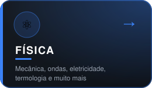
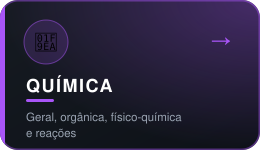
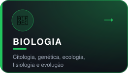
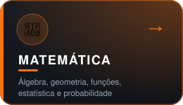
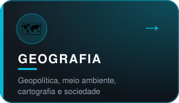
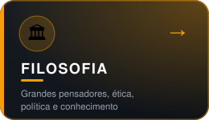
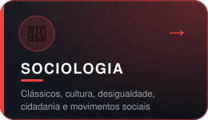
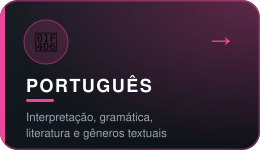

<div align="center">

<a href="https://git.io/typing-svg">
  
</a>

<br/>


</div>

---

<div align="center">

## 📚 &nbsp;Plataforma de Estudos ENEM

**Resumos, conteúdos e materiais organizados por matéria — criados por mim, abertos para todos.**
Escolha uma disciplina abaixo e comece a estudar agora mesmo. 👇

</div>

<br/>

<div align="center">


<p align="center">
  <a href="https://rafaelliwu.github.io/FisicaEnem/#/"></a>&nbsp;&nbsp;<a href="https://rafaelliwu.github.io/QuimicaEnem/#/"></a>&nbsp;&nbsp;<a href="https://rafaelliwu.github.io/BiologiaEnem/#/"></a>
</p>

<br/>


<p align="center">
  <a href="https://rafaelliwu.github.io/MatematicaEnem/#/"></a>
</p>

<br/>


<p align="center">
  <a href="https://rafaelliwu.github.io/GeografiaEnem/#/"></a>&nbsp;&nbsp;<a href="https://rafaelliwu.github.io/FilosofiaEnem/#/"></a>&nbsp;&nbsp;<a href="https://rafaelliwu.github.io/SociologiaEnem/#/"></a>
</p>

<br/>


<p align="center">
  <a href="https://rafaelliwu.github.io/PortuguesEnem/#/"></a>
</p>

</div>

<br/>

<div align="center">

### ⚡ Acesso rápido

[](https://rafaelliwu.github.io/FisicaEnem/#/)
[](https://rafaelliwu.github.io/MatematicaEnem/#/)
[](https://rafaelliwu.github.io/QuimicaEnem/#/)
[](https://rafaelliwu.github.io/BiologiaEnem/#/)
[](https://rafaelliwu.github.io/GeografiaEnem/#/)
[](https://rafaelliwu.github.io/FilosofiaEnem/#/)
[](https://rafaelliwu.github.io/SociologiaEnem/#/)
[](https://rafaelliwu.github.io/PortuguesEnem/#/)

</div>

---

## 🎯 &nbsp;Por que criei essas plataformas?

> *Conteúdo de qualidade não deveria depender de mensalidade, cadastro ou anúncio.*

Cada site foi pensado e desenvolvido por mim com um objetivo simples: **tornar o estudo para o ENEM mais claro, organizado e acessível.** Aqui você encontra:

| | Diferencial | O que significa na prática |
|:-:|---|---|
| 🆓 | **Totalmente gratuito** | Sem login, sem paywall, sem pegadinha |
| 🧭 | **Navegação por tópicos** | Encontre o assunto que precisa em poucos cliques |
| 📱 | **Responsivo** | Estude no celular, tablet ou computador |
| ⚡ | **Leve e rápido** | Páginas estáticas, carregamento instantâneo |
| 🎨 | **Visual limpo** | Foco total no conteúdo, sem distrações |
| 🔄 | **Em constante evolução** | Novos conteúdos e melhorias o tempo todo |

---

## 🗓️ &nbsp;Como estudar com esses materiais

```text
  1️⃣  Escolha a matéria em que você tem mais dificuldade
          │
  2️⃣  Leia o resumo do tópico com calma e anote os pontos-chave
          │
  3️⃣  Pratique com questões de provas anteriores do ENEM
          │
  4️⃣  Revise os erros e volte ao conteúdo quando precisar
          │
  5️⃣  Repita o ciclo — constância vence intensidade 🏆
```

<details>
<summary><b>💡 Dicas rápidas para o ENEM (clique para abrir)</b></summary>

<br/>

- 📌 **Priorize os temas mais cobrados** em cada área antes de aprofundar.
- ⏱️ **Treine com tempo cronometrado** — gestão de prova faz diferença.
- ✍️ **Estude a estrutura da redação** em paralelo às demais matérias.
- 🧠 **Revisões curtas e frequentes** funcionam melhor do que maratonas.
- 😴 **Durma bem e cuide da saúde** — descanso também é estudo.

</details>

---

## 🧰 &nbsp;Tecnologias que uso

<div align="center">


</div>

> 💬 *Os sites de estudo são publicados via **GitHub Pages**, o que os mantém rápidos, estáveis e sem custo de hospedagem.*

---
## 📊 &nbsp;Estatísticas do GitHub

<div align="center">


<br/>


</div>

---

## 🤝 &nbsp;Quer contribuir?

Encontrou um erro, tem uma sugestão de conteúdo ou quer ajudar a melhorar algum dos sites? Sua participação é muito bem-vinda!

1. Abra uma **Issue** no repositório da matéria
2. Descreva a correção ou sugestão
3. Se preferir, envie um **Pull Request** 💙

---

<div align="center">
<br/>

### ⭐ Se algum material te ajudou, compartilhe com um amigo que também está estudando!

*"A educação é a arma mais poderosa que você pode usar para mudar o mundo."* — Nelson Mandela


</div>
